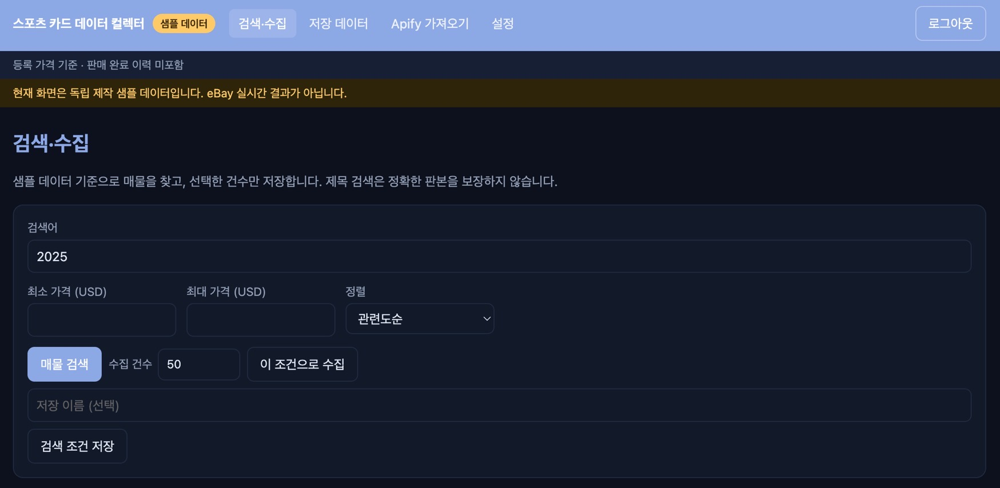
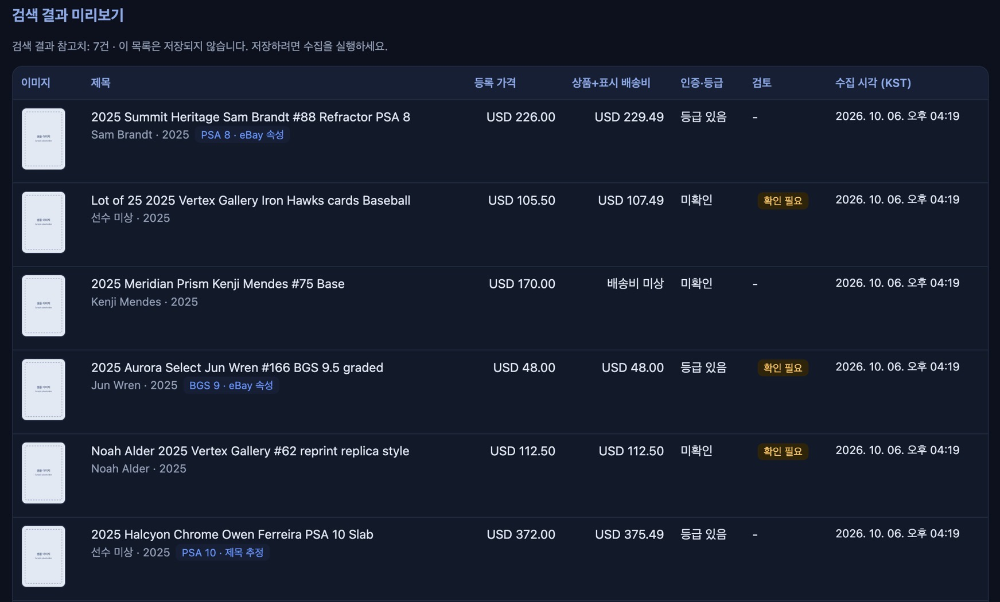

# 스포츠 카드 데이터 컬렉터




eBay 공식 Browse API로 스포츠 카드의 현재 판매 매물을 찾고, 허용된 범위에서 정제해 임시 저장한 뒤 탐색하는 관리자 전용 웹앱입니다. 외부에서 받은 Apify 데이터셋 JSON을 분석하는 기능도 함께 제공합니다.

- 기준 문서: `xref/D06 SPEC Sports_Card_Data_Collector_SPEC_v1.1.md` (v1.1, v1.0은 이력용으로 보관)
- 가격은 모두 **등록 가격 기준**입니다. 판매 완료 이력, 시세, 가격 추천은 포함하지 않습니다.

## 이번 변경 사항 (SPEC v1.1 반영)

| 구분 | 내용 |
|---|---|
| Apify 가져오기 (신규) | 데이터셋 JSON을 올리면 **브라우저 안에서** 분석합니다. 파일은 서버로 보내거나 저장하지 않습니다. 단일 카드·묶음·카드 외 카테고리를 나누고, 등록 가격 통계(최저·중앙값·평균·최고), 상태·인증 기관·판본별 중앙값, 속성 충족률, 검토 항목, 가장 싼 매물 10건을 보여 줍니다. |
| 로컬 실행 포트 | `npm run dev`가 **http://localhost:5181**에서 화면과 `/api`를 함께 제공합니다. `vercel dev` 없이 배포와 같은 `dispatch` 로직을 씁니다. |
| 정책 개정 (SPEC 3.4) | Apify·웹 스크래핑은 "연결하지 않음"에서 **"조건을 갖춘 경우에만 연결"**로 바뀌었습니다. 기본은 eBay 공식 API이고, API 실패 시 자동 전환은 하지 않습니다. |
| 출처 분리 | 데이터 출처를 `mock / live / sandbox / apify_import`로 구분합니다. 서로 다른 출처를 같은 목록이나 통계에 섞지 않습니다. |
| 공유 정제 규칙 | 속성 정제 규칙을 `shared/`로 옮겨 서버 API와 브라우저 분석이 같은 규칙을 씁니다. |
| 테스트 | 48개 (정제 규칙, 소수점 계산, 수집 중복·재개·예산, 만료, CSV 보안, 인증·CSRF, Apify 파싱·분석, 실제 파일 검증) |

## 수정한 오류

1. **관리자 비밀번호 해시가 깨지던 문제 (`.env.local`)**
   - 증상: 비밀번호가 맞아도 로그인이 `INVALID_CREDENTIALS`로 실패했습니다.
   - 원인: Vite가 `.env` 값의 `$`를 변수로 해석해서 해시 중간이 잘렸습니다.
   - 조치: 해시의 `$`를 `\$`로 이어 써야 합니다. 아래 실행 방법에 예시를 넣었습니다.

2. **인증 기관 표기 오집계**
   - 증상: 인증 기관이 `PROFESSIONAL SPORTS AUTHENTICATOR (PSA)`로 그대로 집계됐고, `NOT PROFESSIONALLY GRADED`가 인증 기관으로 잘못 세어졌습니다.
   - 조치: 약어(PSA·BGS·SGC·CGC)만 남기고, "미인증" 표기는 미등급으로 처리합니다. 회귀 테스트를 추가했습니다.

3. **검색 화면 진행 상태 표시 불일치**
   - 증상: 수집 중에도 "진행 중" 표시와 버튼 상태가 갱신되지 않을 수 있었습니다.
   - 조치: 실행 여부를 React 상태로 관리하고, 화면을 떠나면 단계 호출을 멈추도록 했습니다.

4. **로컬 `/api` 미제공**
   - 증상: `vite`만 실행하면 `/api`가 동작하지 않았습니다.
   - 조치: 개발 서버에 `/api` 미들웨어를 추가해 배포 함수와 같은 로직을 호출하도록 했습니다.

## 실행 방법

```bash
npm install
npm run hash:password -- "12자 이상의 관리자 비밀번호"   # 출력값을 아래 ADMIN_PASSWORD_HASH에 넣기
```

`.env.local` 파일을 만듭니다. 이 파일은 `.gitignore`에 있어 커밋되지 않습니다.

```dotenv
DATA_MODE=mock
# 해시의 $ 는 반드시 \$ 로 이어 써야 합니다 (Vite 가 $ 를 변수로 읽음)
ADMIN_PASSWORD_HASH=scrypt\$솔트\$해시
SESSION_SECRET=임의의-긴-문자열
CRON_SECRET=임의의-긴-문자열
```

```bash
npm run dev           # http://localhost:5181 (화면 + /api)
npm test              # 48개 테스트
npm run typecheck
npm run build
```

샘플 60건(야구·농구·축구 각 20건)은 가상의 선수명·브랜드·가격·ID로 독립 작성했습니다. 실제 eBay 링크를 만들지 않습니다.

### Apify 데이터 가져오기

1. 메뉴의 **Apify 가져오기**를 엽니다.
2. Apify eBay 검색 결과 JSON(객체 배열)을 선택합니다.
3. 분석 결과가 브라우저 안에서 바로 나타납니다.

판매자 계정명과 판매 완료 수량(`quantitySold`)은 읽지 않습니다. 원본 Apify 파일은 저장소에 올리지 않으며, `xref/`의 해당 파일은 `.gitignore`로 제외합니다.

## 구현 상태

| 영역 | 상태 |
|---|---|
| 샘플 검색·목록·상세·필터·정렬·페이지 | 구현 |
| 관리자 로그인 (scrypt 해시, HttpOnly 세션, 로그인 잠금, Origin 검증) | 구현 |
| 수집 작업 (step 단위, lease, cursor, 중복 없는 upsert, 중단·재개, 최대 200건) | 구현 |
| 호출 예산 예약 (`BUDGET_EXCEEDED` 시 일시 중지) | 구현 |
| 정제 (구조화 속성 우선, 제목 추정 출처 표시, 상충·묶음·복각 검토) | 구현 |
| 표시 만료 (목록·상세·내보내기에서 서버가 검사) | 구현 |
| CSV/JSON 내보내기 (수식 삽입 방어, 실데이터는 `ENABLE_LIVE_EXPORT=true` 필요) | 구현 |
| 검색 조건 저장 | 구현 |
| 만료 정리 Cron (`/api/maintenance/purge`, 매일 03:00 UTC, CRON_SECRET 필요) | 구현 |
| Apify JSON 가져오기·분석 | 구현 (브라우저 내 분석, 서버 저장 없음) |
| **저장소** | **임시 메모리 저장소.** 로컬·테스트용. 서버리스 인스턴스 간 공유되지 않으므로 운영 배포 전 Neon 구현으로 교체 필요 |
| **eBay 실데이터 (OAuth·Browse)** | **미구현.** `server/ebay/live-adapter.ts`는 `EBAY_ACCESS_NOT_READY`를 반환합니다. 운영 접근 승인 후 구현 |
| **Apify 실행 연동 (`APIFY_ENABLED`)** | **미구현.** 현재는 파일 가져오기만 동작합니다 (SPEC 3.4) |
| **Drizzle 스키마·마이그레이션, `db:*` 스크립트** | 미구현. 스키마 기준은 SPEC 7절 |
| 품질 요약 (P1), 자동 정기 수집 | 미구현 (SPEC 범위 밖 또는 후속) |

`DATA_MODE=live`로 설정하면 실데이터 어댑터가 호출되며, 승인 전에는 명확한 오류를 보여줍니다. 샘플 데이터로 대체하지 않습니다.

## 디렉터리

```
api/[...route].ts      Vercel 함수 진입점 (모든 /api/* 를 dispatch 로 전달)
vite.config.ts         개발 서버(5181)와 로컬 /api 미들웨어
server/                서버 전용 코드. 브라우저 번들에서 import 하지 않음 (tests/boundary.test.ts 가 검사)
  http/dispatch.ts     라우팅, 인증, CSRF 검사, 응답 형식
  services/            수집 작업, 매물, 검색 조건
  ebay/                mock 어댑터, live 어댑터(미구현), 매핑, 정렬 allowlist
  policies/            예산, 만료, 내보내기
  store/               임시 메모리 저장소
  mocks/fixtures.ts    독립 제작 샘플 60건
shared/                서버와 브라우저가 함께 쓰는 코드
  normalize.ts         속성 정제 규칙
  apify/parse.ts       Apify 데이터셋 파싱 (판매자 정보·판매 완료 필드 제외)
  apify/analyze.ts     가격 통계 (정수 센트 계산)
src/                   React + Vite 화면 (한국어 UI)
tests/                 Vitest
docs/images/           README 스크린샷
scripts/hash-password.mjs
```

## API 요약

모든 데이터 API는 관리자 세션을 요구합니다. 예외는 `auth/login`, `auth/logout`, `maintenance/purge`(CRON_SECRET)입니다.

| 메서드 | 경로 | 설명 |
|---|---|---|
| POST | /api/auth/login | `{password}` → 세션 쿠키 |
| POST | /api/auth/logout | 세션 폐기 |
| GET | /api/status | 모드·연결 상태·예산 (비밀 제외) |
| POST | /api/ebay/search | 검색 미리보기 (저장하지 않음, total 은 참고치) |
| GET | /api/listings | 저장 매물 목록 (`page`, `pageSize`, 필터, `sort`) |
| GET/POST/DELETE | /api/listings/:id, /:id/refresh | 상세, 상세 갱신, 캐시 삭제 |
| POST | /api/collection-jobs | `{criteria, maxItems, idempotencyKey?}` → 작업 생성 |
| POST | /api/collection-jobs/:id/step | 검색 1페이지 또는 상세 최대 5건 처리 |
| POST | /api/collection-jobs/:id/cancel, /resume | 중단, 재개 |
| GET/POST/DELETE | /api/saved-searches | 검색 조건 저장 (`DELETE ?id=`) |
| POST | /api/exports | `{format: csv\|json, filters}` |

성공: `{ data, meta: { sourceMode, observedAt, requestId }, warnings }`
실패: `{ error: { code, message, retryable }, requestId }`

## 배포 전 확인

1. Neon 연결과 `DATABASE_URL`을 준비하고, 임시 메모리 저장소를 Neon 구현으로 교체합니다.
2. eBay 개발자 계정의 Production 키 발급과 Browse API 운영 접근 조건을 확인합니다. 키 생성만으로 승인이 끝나지 않습니다.
3. 허용 카테고리 목록과 확인일을 설정 파일에 기록합니다 (SPEC 5.1).
4. 저장·내보내기 정책은 SPEC 3.3을 기준으로 운영자가 확인한 뒤 `LIVE_CACHE_TTL_SECONDS`와 `ENABLE_LIVE_EXPORT`를 정합니다.
5. Vercel Preview와 Production에 환경변수를 각각 설정합니다. `.env.example`에는 실제 값을 넣지 않습니다.
